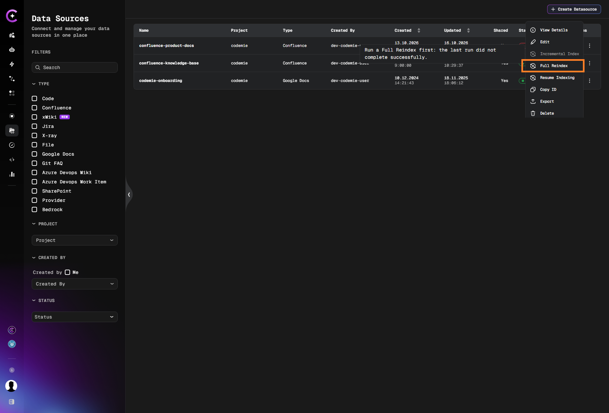
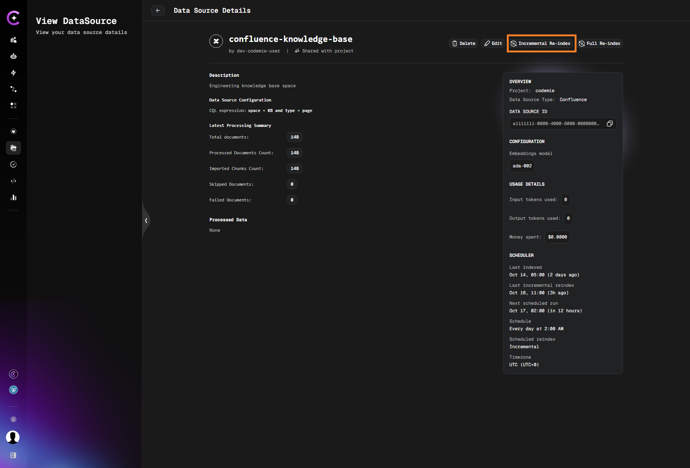

# Indexing Data Sources

Learn how to index data sources for better searchability and access.

Once a data source is added to the AI/Run CodeMie platform, you can proceed with indexing it. Indexing enables assistants and workflows to interact with the data within the data source. Assistants can only access data that has been indexed, so you need to re-index the data source each time it is updated. Otherwise, AI/Run CodeMie will not recognize the new data.

## Automatic Indexing

By default, AI/Run CodeMie automatically indexes new data sources as soon as they are added to the platform:


:::info
You do not have to wait until a data source is fully indexed. You can already add this data source to your assistants.
:::

:::warning Partial Data Access
If you add a data source before indexing completes, assistants will only access already-indexed content. Wait for full indexing for complete coverage.
:::

## Manual Reindexing

To manually trigger data source reindexing, click the actions button and select **Full Reindex** or **Incremental Index**:


### Indexing Types

#### Full Reindex

A complete reindexing of the data source. This involves scanning and updating all data from the source, regardless of any changes.

**When to use Full Reindex:**

- After major updates to the data source
- When data integrity issues are suspected
- For initial indexing of large data sources
- When switching indexing strategies or configurations

#### Incremental Index

Only content that was **added, changed or removed** since the last successful run is processed. Unchanged content is not read or embedded again, so the run is faster and uses fewer embedding calls than a full reindex.

**When to use Incremental Index:**

- For frequent, small updates to large data sources
- To save time and resources on regular synchronization
- When only recent changes need to be reflected

**Rules that apply to all data sources:**

| Rule                                                           | Behavior                                                                                   |
| -------------------------------------------------------------- | ------------------------------------------------------------------------------------------ |
| Two actions                                                    | **Incremental Index** processes only the changes; **Full Reindex** processes everything.   |
| After a failed run                                             | **Incremental Index** is disabled (greyed out, with a hint). Run a **Full Reindex** first. |
| Deleted content                                                | Removed from the index during an incremental run.                                          |
| Changed scope (query, space, site, filter, repository, branch) | Requires a **Full Reindex**. Incremental is refused with a message.                        |
| A single document fails                                        | Retried on the next incremental run instead of being skipped silently.                     |
| Data Source Details page                                       | Shows when the last incremental run was triggered.                                         |

#### Incremental Support by Data Source

The **watermark** is the point the next incremental run starts from. For date-based sources, it is the start time of the previous successful run (the later of the last full reindex and the last incremental run). The start time is used instead of the end time so that edits made while a run is in progress are not lost.

| Data Source                 | Watermark                            | How changes are found                                                                 | How removals are found                                                            | Notes                                                                                                   |
| --------------------------- | ------------------------------------ | ------------------------------------------------------------------------------------- | --------------------------------------------------------------------------------- | ------------------------------------------------------------------------------------------------------- |
| **Git (code)**              | Last indexed commit                  | Differences between that commit and the current HEAD                                  | Files deleted in the diff are removed; for renamed files, the old path is removed | Watermark is saved only after the run succeeds                                                          |
| **Git FAQ**                 | Last indexed commit                  | Differences between that commit and the current HEAD, per FAQ article                 | Files deleted in the diff are removed                                             | Without a stored watermark, the index is fully rebuilt                                                  |
| **SVN**                     | Last indexed revision                | Differences between the last indexed and the current revision                         | Files deleted in the diff are removed                                             |                                                                                                         |
| **Confluence**              | Start of the previous successful run | Pages with `lastModified` on or after the watermark                                   | Indexed pages that no longer match the query are removed                          | Minute precision. Trashed pages still match until the trash is emptied, so they stay indexed until then |
| **Jira**                    | Start of the previous successful run | Issues with `updatedDate` on or after the watermark (1-minute overlap)                | Indexed issues that no longer match the JQL are removed                           | Scheduled runs are always incremental                                                                   |
| **X-ray**                   | Start of the previous successful run | Tests with `updatedDate` on or after the watermark (1-minute overlap)                 | Indexed tests that no longer match the JQL are removed                            | Scheduled runs are always incremental                                                                   |
| **Azure DevOps Work Items** | Start of the previous successful run | Work items with `ChangedDate` on or after the watermark                               | Indexed items that no longer match the query are removed                          |                                                                                                         |
| **Azure DevOps Wiki**       | Start of the previous successful run | Pages whose last-changed date (from the wiki's Git repository) is after the watermark | Pages deleted from the wiki are removed                                           |                                                                                                         |
| **SharePoint**              | Start of the previous successful run | Files and pages with `lastModifiedDateTime` after the watermark                       | Indexed items no longer found in the site or filter are removed                   |                                                                                                         |
| **Google Docs**             | Hash of the document text            | Document is fetched and its hash compared with the stored one                         | Not applicable: single document, old chunks are replaced on re-index              | Existing data sources are re-indexed once after the release that introduced this                        |
| **xWiki**                   | Start of the last successful run     | Pages whose `modified` date is after the watermark                                    | Pages no longer in the space are removed                                          | A failed run never moves the watermark                                                                  |
| **File**                    | None                                 | Not incremental by design                                                             | Not applicable                                                                    | Upload the changed files again                                                                          |

:::note Alternative Access
**Full Reindex** is also available on the **Data Source Details** page: Data Source tab → Selected data source → 3 dots → View → scroll the page to the bottom.
:::



The **Data Source Details** page shows when the last incremental run was triggered:



## Automatic Reindexing with Scheduler

Instead of manually triggering reindexing, you can configure automatic reindexing schedules directly in the data source settings. The built-in scheduler is available for all data source types except Provider and File data sources.

### Setting Up Automatic Reindexing

The scheduler can be configured when creating a new data source or when updating an existing one:

1. Navigate to your data source creation or update form
2. Locate the **Reindex Type** section
3. Select your preferred schedule from the **Scheduler** dropdown

### Incremental Scheduled Runs

Below the **Scheduler** field, the **Run scheduled reindex incrementally** switch controls what each scheduled run does:

- **Off (default)** - Each scheduled run is a full reindex.
- **On** - Each scheduled run is incremental. If the previous run failed, the next scheduled run falls back to a full reindex automatically.

Jira and X-ray scheduled runs are always incremental, regardless of the switch.

Via the API or SDK, send `"scheduled_incremental": true` together with the cron expression in the create or update data source request. If the field is omitted, the stored value is kept.

```json
{
  "cron_expression": "0 0 * * *",
  "scheduled_incremental": true
}
```

### Available Schedules

- **No schedule (manual only)** - Default, manual reindexing only
- **Every hour** - Automatic reindexing every hour
- **Daily at midnight** - Once per day at midnight
- **Weekly on Sunday at midnight** - Once per week
- **Monthly on the 1st at midnight** - Once per month
- **Custom cron expression** - Enter your own cron expression for custom timing

### When to Use Scheduled Reindexing

**Use automatic scheduling when:**

- Data source updates regularly (Git repos, Confluence, Jira)
- You want assistants to always have access to latest content
- You prefer a "set it and forget it" approach

**Use manual reindexing when:**

- Data source rarely changes
- You have full control over update timing
- Working in development/testing environments
- Data source is very large and updates infrequently

For detailed scheduler configuration, see the [Scheduler documentation](/user-guide/tools_integrations/tools/scheduler).

## Resuming Indexing

If indexing is interrupted or paused, you can resume the process by clicking the **Resume Indexing** button:


## Scheduler Reindex Behavior

The type of each scheduled run depends on the data source and the **Run scheduled reindex incrementally** switch:

| Data Source                                                                           | Switch off (default) | Switch on   |
| ------------------------------------------------------------------------------------- | -------------------- | ----------- |
| Jira, X-ray                                                                           | Incremental          | Incremental |
| Git, Confluence, Google Docs, Azure DevOps (Wiki, Work Items), SharePoint, xWiki, SVN | Full                 | Incremental |
| AWS Knowledge Bases                                                                   | Full                 | Full        |

After a failed run, the next scheduled run is always a full reindex.

## Indexing Best Practices

### Data Sources with Scheduler Support

The built-in automatic reindexing scheduler availability by data source type:

| Data Source Type    | Automatic Scheduler |
| ------------------- | ------------------- |
| Git Repositories    | ✅ Available        |
| Confluence          | ✅ Available        |
| Jira                | ✅ Available        |
| Google Docs         | ✅ Available        |
| AWS Knowledge Bases | ✅ Available        |
| X-ray               | ✅ Available        |
| File                | ❌ Not available    |
| Provider            | ❌ Not available    |

### Monitoring Indexing Status

Keep track of your data source indexing status:

- Check the **STATUS** column in the data sources list
- Monitor indexing progress for large data sources
- Verify successful completion of indexing operations
- Review any indexing errors or warnings

### Optimizing Indexing Performance

- **Schedule Large Reindexes**: Perform full reindexes during off-peak hours
- **Use Incremental Indexing**: Prefer incremental indexing for regular synchronization; use full reindex after changing the data source scope or a failed run
- **Batch Updates**: Group multiple changes before triggering reindex
- **Clean Up First**: Remove outdated or unnecessary data before reindexing

:::danger Data Loss Warning
Full reindex replaces all existing indexed data. If your data source has changed significantly (e.g., repository deleted, Confluence pages removed), those items will be removed from search results.
:::

## Indexing Status Indicators

Data sources display different statuses during the indexing process:

- **Indexing**: Currently being indexed
- **Indexed**: Successfully indexed and ready to use
- **Failed**: Indexing encountered an error
- **Pending**: Waiting to start indexing
- **Paused**: Indexing process is paused

Now your data sources are indexed and ready to be used by assistants and workflows for enhanced AI-powered operations.
